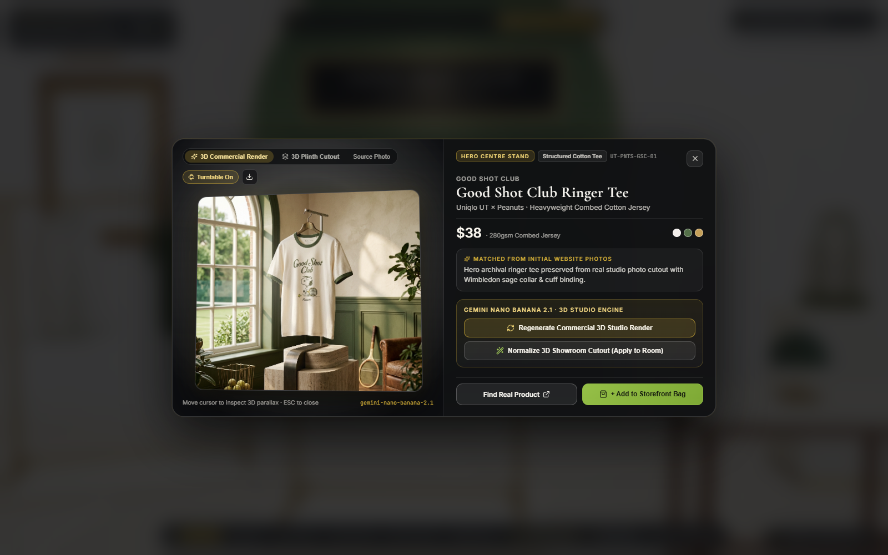
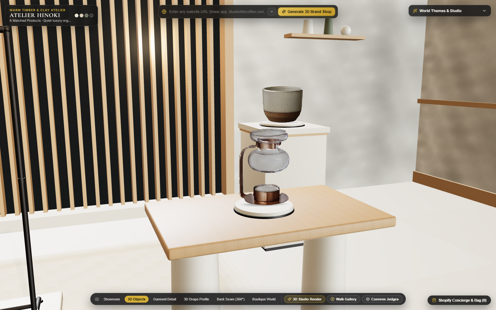
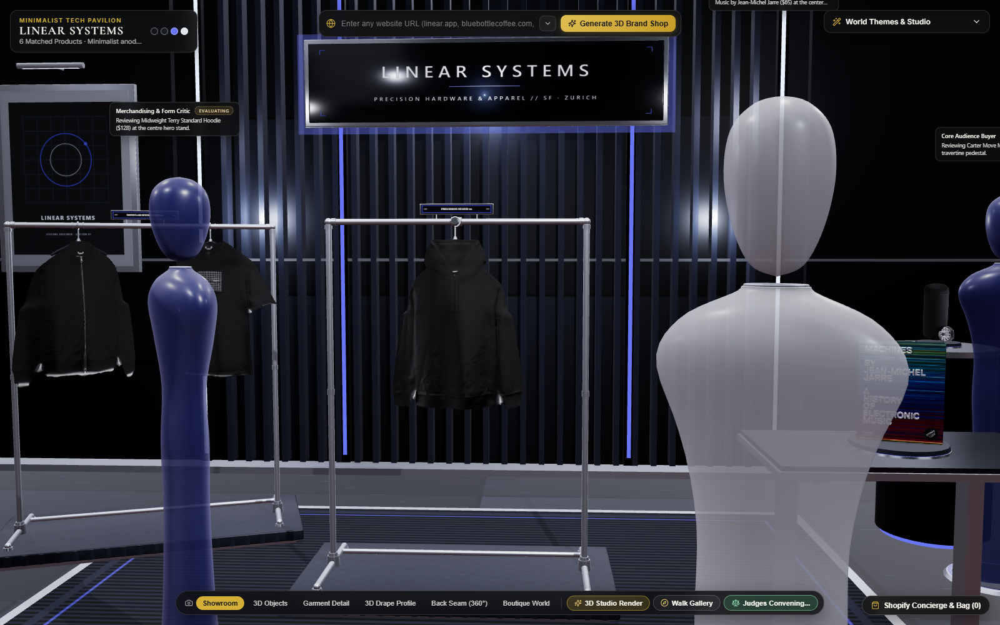
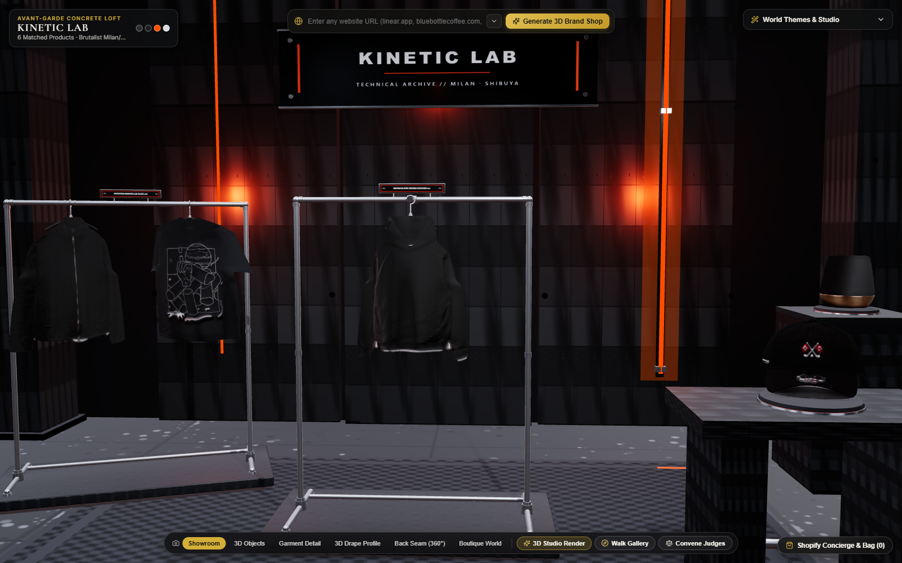
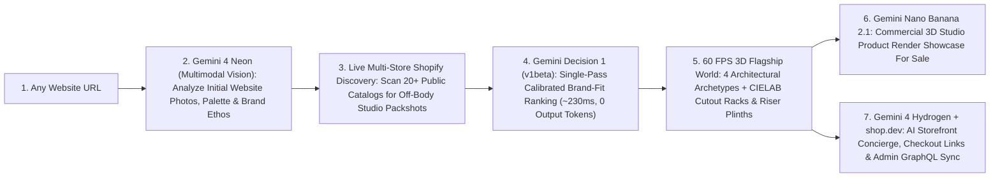

# ATELIER 119 — URL → Real Internet Products → 3D Brand World & Commercial Studio Engine

> **Gemini 4 NYC Hackathon (Nov 21, 2026)**  
> **Primary Track:** Problem Statement Two — **Element 119** *(Multimodal Vision, Spatial World Synthesis & Generated Commercial Media + Decisions API)*  
> **Bonus Track:** **Build with Commerce (`Shopify` / `shop.dev`)** *(Live Multi-Store Catalog Discovery, AI Storefront Concierge & GraphQL Sync)*

**ATELIER 119** turns **any website URL** (e.g., `a24films.com`, `linear.app`, `bluebottlecoffee.com`, `rowingblazers.com`, `kotn.com`) into a curated, walkable **3D flagship boutique** stocked with **real matching products pulled from live e-commerce catalogs across the internet**—complete with live **`gemini-nano-banana-2.1` commercial 3D studio renders for sale**, **formal sculptural silhouette judges** powered by **`gemini-decision-1`**, and a **Shopify AI Concierge**.

---

## 🖼️ Live Showroom & Studio Render Captures

| Commercial 3D Studio Render (`gemini-nano-banana-2.1`) | Warm Timber & Clay Atelier (`PhotorealObjectStand3D`) |
| :---: | :---: |
|  |  |
| **Minimalist Tech Pavilion + Silhouette Judges** | **Avant-Garde Concrete Loft + Real Packshots** |
|  |  |

---

## ⚡ 30-Second Quickstart

```bash
git clone https://github.com/Spadeyache/gemini4_hackathon_2026_11_21.git
cd gemini4_hackathon_2026_11_21
npm install
cp .env.example .env   # PowerShell: Copy-Item .env.example .env
# Add your GEMINI_API_KEY (and optional GEMINI_API_KEY_2 backup key) to .env
npm run dev
```

1. Open the local Vite URL (`http://localhost:5173` or next available port).
2. **Paste any website URL** in the top bar and click **`Generate 3D Brand Shop`**.
3. **Click any hanging garment or pedestal object** (or **`3D Studio Render`** in the bottom dock) to generate a live **`gemini-nano-banana-2.1`** commercial 3D studio campaign render for sale, normalize cutouts back into the 3D showroom, or open the real Shopify product listing.
4. Click **`Walk Gallery`** (`WASD` + mouse look) to walk through the 3D showroom or **`Convene Judges`** to watch the 4 formal silhouette critics evaluate the collection via **`gemini-decision-1`**.

---

## 🧠 Multi-Model Gemini 4 + Decisions API + Shopify Pipeline



### Models & Roles (`@google/genai@^3.6.1`)

| Model | API Surface | Exact Role in ATELIER 119 |
| :--- | :--- | :--- |
| **`gemini-4-neon`** | `ai.interactions.create` (`v1`) | Multimodal vision analysis of extracted initial website photos (`og:image`, hero photography) + CSS/SVG palette to choose the 3D architectural world archetype and targeted visual product search queries (`server/brandIngestPlugin.ts`). |
| **`gemini-decision-1`** | `ai.decisions.create` (`v1beta`) | Calibrated single-pass `noul` (yes/no probability) & `choice` scoring (~`230ms`, zero output tokens) to rank real internet product candidates for brand fit AND drive the 4 formal silhouette product judges (`server/brandIngestPlugin.ts`, `server/gemini4DecisionsPlugin.ts`). |
| **`gemini-nano-banana-2.1`** | `ai.interactions.create` (`v1`) | Generates bespoke commercial 3D studio product renders on architectural stone/concrete/titanium pedestals for sale, plus normalized 3D showroom cutouts (`server/studioRenderPlugin.ts`, `src/components/products/StudioProductModal.tsx`). |
| **`gemini-4-hydrogen`** | `ai.interactions.create` (`v1`) | Powers real-time judge commentary and the **Shopify AI Merchandising Concierge** (`POST /api/shopify/chat`), grounding recommendations in real pricing, materials, comparable blanks, and `shop.dev` checkout/publish payloads (`server/shopifyCommercePlugin.ts`). |

---

## 🏛️ Key Engineering Highlights

- **4 Dynamic 3D Architectural Archetypes (`src/components/BoutiqueWorld.tsx`):**
  - `minimalist_tech_pavilion` *(anodized obsidian slat walls, indigo LED channels, coffered daylight ceiling)*
  - `avant_garde_concrete_loft` *(board-formed poured concrete monoliths, safety-orange architectural neon, brushed chrome rails)*
  - `warm_artisanal_atelier` *(rammed-earth clay plaster, vertical white-oak louver screen, blackened bronze hardware)*
  - `heritage_arch_flagship` *(recessed fluted sage arch alcove, Venetian limewash, honed Roman travertine)*
- **Photorealistic Real-Product Cutout Pipeline (`src/lib/garmentProcessor.ts`, `src/components/products/PhotorealObjectStand3D.tsx`, `src/components/HangingGarment.tsx`):**
  - Perceptual CIELAB flood-fill background removal, studio drop-shadow & enclosed armpit-slit stripping, un-mirrored 360° back synthesis, Sobel PBR surface normal maps, dual-sided volumetric cloth shells on 3D hangers, and 8-layer volumetric relief object stands on 2.2cm brushed-metal & stone risers.
- **Hot-Reloaded Multi-Key Failover Pool (`server/geminiKeyPool.ts`):**
  - Round-robins and automatically fails over across `GEMINI_API_KEY`, `GEMINI_API_KEY_2`, `GEMINI_API_KEY_3`, and `GEMINI_API_KEYS` without restarting Vite.
- **Shopify Commerce Integration (`server/shopifyCommercePlugin.ts`, `src/features/shopify/ShopifyConciergeDrawer.tsx`):**
  - Pulls real buyable products from public Shopify catalogs, generates live Shopify cart permalinks / Storefront GraphQL `cartCreate` checkouts, and exports `shop.dev` Admin GraphQL `productCreate` & `collectionCreate` manifests.

---

## 📁 Project Structure

```text
├── server/
│   ├── brandIngestPlugin.ts       # URL -> initial photo extraction -> gemini-4-neon -> live Shopify matcher -> gemini-decision-1
│   ├── studioRenderPlugin.ts      # Live gemini-nano-banana-2.1 commercial 3D studio render & cutout cache endpoint
│   ├── gemini4DecisionsPlugin.ts  # Single-pass gemini-decision-1 calibrated persona & store mutation endpoint
│   ├── shopifyCommercePlugin.ts   # Shopify Storefront/Admin GraphQL + gemini-4-hydrogen AI concierge
│   └── geminiKeyPool.ts           # Hot-reloaded multi-key round-robin & HTTP 429 failover pool
├── src/
│   ├── components/
│   │   ├── BoutiqueWorld.tsx      # 4 distinct procedural PBR 3D architectural showroom worlds
│   │   ├── BoutiqueRack.tsx       # Brushed metal hero faceout & capsule rails
│   │   ├── HangingGarment.tsx     # Volumetric dual-sided hanging garment cloth shell + 3D hanger
│   │   └── products/
│   │       ├── PhotorealObjectStand3D.tsx # Multi-slice volumetric relief display stand for real object cutouts
│   │       └── StudioProductModal.tsx     # Interactive 3D parallax "For Sale" modal (gemini-nano-banana-2.1)
│   ├── features/
│   │   ├── ingestion/UrlIngestBar.tsx         # Floating URL intake bar + live pipeline telemetry
│   │   ├── shoppers/ShopperSwarmLayer.tsx     # 4 formal frosted-monolith sculptural silhouette judges
│   │   ├── player/RobloxPlayerController.tsx  # Smooth first-person WASD gallery walkthrough
│   │   └── shopify/ShopifyConciergeDrawer.tsx # Shopify AI concierge chat, bag & GraphQL publisher
│   ├── data/presets.ts            # 4 instant-load flagship worlds with verified real studio packshots
│   └── lib/garmentProcessor.ts    # Browser CIELAB cutout, shadow stripper & Sobel PBR normal map engine
└── docs/screenshots/              # Captured WebGL showroom & Gemini Nano Banana 2.1 studio renders
```
