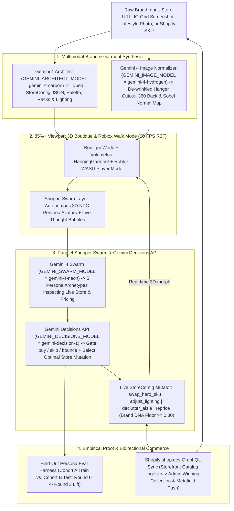

# gemini4_hackathon_2026_11_21

## ATELIER 119 — Multimodal URL/Image-to-3D Boutique & Synthetic Shopper Engine

> **Gemini 4 NYC Hackathon (Nov 21, 2026) · Hard Cutoff: 5:00 PM ET**  
> **Primary Track:** Problem Statement Two — **Element 119** *(Synthesizing an Emergent Spatial Medium)*  
> **Bonus Track:** **Build with Commerce (`Shopify` / `shop.dev`)** *(Bidirectional Storefront & Admin GraphQL Loop)*

**ATELIER 119** transforms a single garment photo, brand URL, Instagram grid screenshot, or live **Shopify** catalog into a walkable, magazine-grade **3D architectural flagship boutique**—and then populates the floor with an autonomous **Synthetic Shopper Swarm** powered by **Gemini 4** + the **Gemini Decisions API** (`gemini-decision-1`) to mutate lighting, aisle layout, hero faceouts, and pricing in real time until held-out conversion peaks.

Instead of flat 2D e-commerce grids or slow, melted 3D NeRF meshes that blur screen-printed typography, **ATELIER 119** pairs **Stage A Multimodal Garment Hang Normalization** (`gemini-4-hydrogen`) with **Stage B 60 FPS Parametric Volumetric Cloth Shells**, **Roblox-style `WASD` player walk mode**, and live **closed-loop spatial merchandising** synced straight back to Shopify (`shop.dev`).

---

## ⚡ 30-Second Teammate Quickstart

All pre-baked PBR showroom textures (`travertine`, `limewash`, `sage-fluted-wood`) and normalized volumetric garment layers in `public/assets/**` are tracked directly in Git—cloning boots a 60 FPS 3D flagship out of the box even before adding API keys!

```bash
git clone https://github.com/Spadeyache/gemini4_hackathon_2026_11_21.git
cd gemini4_hackathon_2026_11_21
npm install
cp .env.example .env   # PowerShell: Copy-Item .env.example .env
npm run dev
```

1. Open **`http://localhost:5173`** — the interactive 3D showroom fills **≥85% of the viewport**.
2. Fill in `.env` with your team's `GEMINI_API_KEY` and `SHOPIFY_*` credentials (see [`.env.example`](.env.example)).
3. Verify production TypeScript + Vite build before opening any PR:
   ```bash
   npm run build
   ```
4. *(Team Lead one-liner)* Publish all 8 sprint issues + labels to GitHub:
   ```powershell
   .\scripts\create_github_issues.ps1
   ```

---

## 🏗️ Multi-Model Gemini 4 + Decisions API + Shopify Architecture



### Environment & Model Roster (`.env.example`)

| Variable | Default / Target | Role in ATELIER 119 |
| :--- | :--- | :--- |
| `GEMINI_API_KEY` | *(required for live API)* | Shared Gemini 4 + Decisions API authentication key |
| `GEMINI_ARCHITECT_MODEL` | `gemini-4-carbon` | Deep multimodal Brand & Store Architect (`URL` / IG grid / photo -> `StoreConfig` JSON + Brand DNA guardrails) |
| `GEMINI_SWARM_MODEL` | `gemini-4-neon` | High-throughput parallel Synthetic Shopper Swarm evaluating racks, lighting & price tiers |
| `GEMINI_IMAGE_MODEL` | `gemini-4-hydrogen` | Messy lifestyle / human-model / IG garment photo normalization into clean studio hanger RGBA cutouts |
| `GEMINI_DECISIONS_MODEL` | `gemini-decision-1` | **Gemini Decisions API** structured `buy` / `skip` / `bounce` routing & reward-maximizing store mutation gate |
| `SHOPIFY_STORE_DOMAIN` | `*.myshopify.com` | Target Shopify store domain for `shop.dev` GraphQL sync |
| `SHOPIFY_STOREFRONT_ACCESS_TOKEN` | *(Shopify token)* | Storefront GraphQL API product, variant, pricing & image catalog ingestion |
| `SHOPIFY_ADMIN_ACCESS_TOKEN` | *(Shopify token)* | Admin GraphQL API write-back for winning collection sort order, hero metafields & copy |

---

## 🤝 Zero-Merge-Conflict 3-Person Team Ownership Table

To ship cleanly before the **4:15 PM ET feature freeze** (**5:00 PM ET hard cutoff**), the repository is partitioned so **all 3 teammates can code, commit, and merge simultaneously without ever touching the same files**.

### Git Branch & PR Rules
- **Branch format:** `feat/issue-<num>-<slug>` *(e.g. `feat/issue-1-brand-architect`, `feat/issue-5-shopify-sync`, `feat/issue-8-roblox-checkout`)*
- **Shared Contract (Read-Only Lock):** [`src/types/storeConfig.ts`](src/types/storeConfig.ts) is the shared TypeScript boundary. Do not modify existing field names without a 10-second Slack/Discord heads-up; add optional fields (`field?: Type`) if extending.
- **UI Guardrail:** Keep the interactive 3D canvas occupying **≥85% of the viewport** at all times—new controls belong inside compact floating glassmorphic drawers/HUD pills, never full-screen SaaS tables.

| Teammate | Role & Focus | Exclusive Owned Paths (Zero Overlap) | Assigned Issues ([`TEAM_ISSUES.md`](TEAM_ISSUES.md)) | Example Feature Branches |
| :--- | :--- | :--- | :--- | :--- |
| **Teammate 1** | **3D World, Roblox Walkthrough & Live Garment Ingestion** | `src/components/BoutiqueWorld.tsx`<br>`src/components/BoutiqueRack.tsx`<br>`src/components/HangingGarment.tsx`<br>`src/components/CameraRig.tsx`<br>`src/components/Roblox*`<br>`src/components/CheckoutCartDrawer.tsx`<br>`src/lib/garmentProcessor.ts`<br>`scripts/process_garment.py`<br>`scripts/normalize_drape_and_companions.py` | **Issue #4** *(Gemini Image Lifestyle/Model Photo Normalization)*<br>**Issue #8** *(Roblox Walk Mode Checkout Cart, NPC Chat & 1-Min Video HUD)* | `feat/issue-4-lifestyle-garment-norm`<br>`feat/issue-8-roblox-checkout-hud` |
| **Teammate 2** | **Gemini 4 Multi-Model Agents & Decisions API Store Mutation** | `server/index.ts`<br>`server/agents/*`<br>`server/routes/*`<br>`src/components/ShopperSwarmLayer.tsx`<br>`src/services/boutiquePipeline.ts`<br>`src/services/storeOptimizer.ts` | **Issue #1** *(Multimodal Brand Architect `POST /api/ingest-url` + IG Grid Drop)*<br>**Issue #2** *(Synthetic Shopper Swarm + Gemini Decisions API `buy`/`skip`/`bounce`)*<br>**Issue #3** *(Closed-Loop Live `StoreConfig` Mutator)* | `feat/issue-1-brand-architect`<br>`feat/issue-2-shopper-decisions`<br>`feat/issue-3-closed-loop-mutator` |
| **Teammate 3** | **Proof-It-Works Eval Harness, Breaking-Point Stress Test & Shopify `shop.dev` Sync** | `server/shopify/*`<br>`src/services/shopifySync.ts`<br>`src/components/ShopifySyncModal.tsx`<br>`src/components/EvalProofBadge.tsx`<br>`scripts/eval_heldout_personas.*`<br>`scripts/stress_test_element119.*`<br>`docs/PROOF_IT_WORKS.md` | **Issue #5** *(`shop.dev` Storefront Ingest + Admin Winning Collection Sync)*<br>**Issue #6** *(Held-Out Persona Eval Harness: Round 0 vs. Round 3 Lift)*<br>**Issue #7** *(Element 119 Breaking-Point Stress Test + Consensus Damping)* | `feat/issue-5-shopify-sync`<br>`feat/issue-6-heldout-eval-proof`<br>`feat/issue-7-element119-stress-test` |

> **What about `src/App.tsx`?** Keep `src/App.tsx` wiring minimal—each teammate builds self-contained components/services in their owned files first and merges thin `<Component />` mounts via quick 5-line PRs.

---

## 🏆 Judging Rubric Alignment

| Judging Criterion | Weight | How ATELIER 119 Scores Maximum Points |
| :--- | :---: | :--- |
| **Live Demo** | **35%** | Instant `t = 0s` 60 FPS 3D architectural flagship (**≥85% viewport**), drag-and-drop messy garment/IG screenshot -> live room & rack metamorphosis, `WASD` Roblox walk-around + NPC shopper chat, and zero-latency local fallbacks so stage Wi-Fi can never break the demo. |
| **Proof It Works** | **25%** | Disjoint **Critique Cohort A** vs. **Held-Out Evaluation Cohort B** benchmark (`Round 0` uncurated baseline -> `Round 3` optimized store) measuring statistically grounded `buy` conversion lift, `bounce` reduction, Brand DNA coherence (`≥ 0.80`), plus a documented **40-SKU / 50-agent oscillation breaking-point stress test** & consensus damping fix (Issues **#6** & **#7**). |
| **Creativity (Element 119)** | **20%** | Invents an emergent **self-merchandising spatial medium**: garments aren't static JPEGs or melted NeRFs—they hang as crisp dual-sided volumetric cloth shells inside a boutique whose architecture, lighting, and capsule rails evolve autonomously from synthetic human behavior. |
| **Gemini 4 & Decisions API** | **20%** | Orchestrates **3 distinct Gemini 4 models** (`gemini-4-carbon` Architect, `gemini-4-neon` Parallel Shopper Swarm, `gemini-4-hydrogen` Lifestyle Garment Normalizer) tightly coupled with **`gemini-decision-1` (Gemini Decisions API)** for structured `buy`/`skip`/`bounce` gating and closed-loop action selection (`swap_hero_sku`, `adjust_lighting`, `declutter_aisle`, `reprice`). |
| **Shopify Bonus Track (`shop.dev`)** | **Bonus** | Full bidirectional commerce loop: hydrates live `GarmentAssetSet` racks from **Shopify Storefront GraphQL**, runs spatial shopper optimization, and pushes the winning hero order, price anchors, and curatorial metafields back via **Shopify Admin GraphQL** (Issue **#5**). |

---

## 📋 Sprint Backlog & Issue Automation

- Full specs, acceptance criteria, and file boundaries for **Issues #1–#8** live in [**`TEAM_ISSUES.md`**](TEAM_ISSUES.md).
- Architectural guardrails and Stage A/B volumetric garment specs live in [**`CONTEXT.md`**](CONTEXT.md).
- To create all labels and all 8 GitHub Issues on `Spadeyache/gemini4_hackathon_2026_11_21`:
  ```powershell
  .\scripts\create_github_issues.ps1
  ```

### ⏱️ Hackathon Day Run-of-Show (ET)
- **Now – 3:30 PM ET:** Parallel build on `feat/issue-1..8-*` branches inside owned folders.
- **3:30 PM – 4:15 PM ET:** Integration merge, end-to-end Round 0 -> Round 3 eval capture, Shopify live sync check.
- **4:15 PM ET (HARD FEATURE FREEZE):** Record 1-minute demo video (`t = 0s` inside 3D boutique, Issue #8 cinema toggle), audit `.env` vs `.env.example`, rehearse 3-min live pitch + 2-min Q&A.
- **5:00 PM ET:** Final submission locked.
