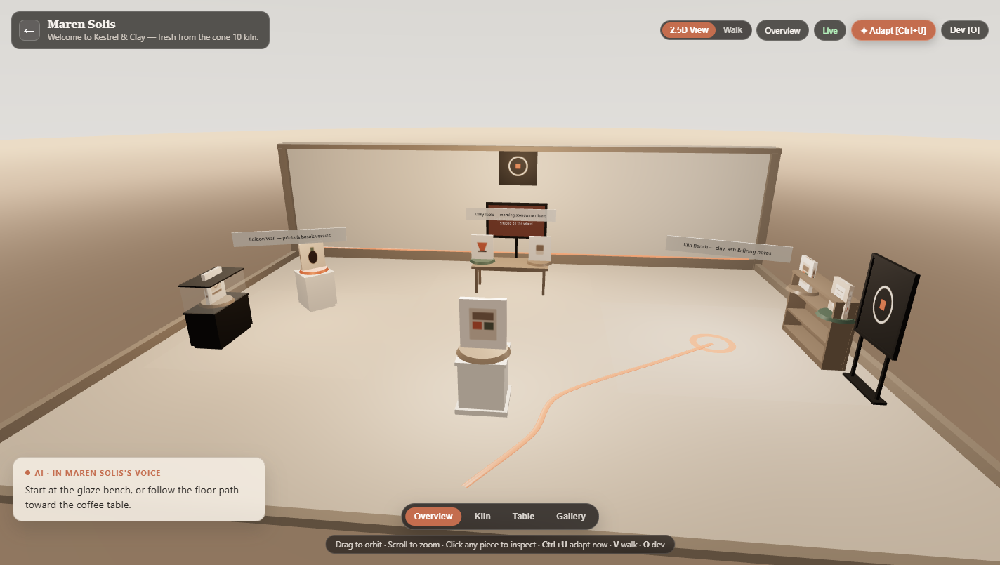

# MyBrand

MyBrand is a personal 3D world for small and midsize creators to share with fans. The idea is simple: share a few images and website links, let AI interpret your style, and give each fan a space that responds to what catches their eye.

In the Kestrel & Clay prototype, you can walk through a ceramics studio and inspect its pieces. Your visit can change which product sits on the central plinth and where the floor path leads next.

**Try it locally.** From `mybrand-starter/mybrand`, run `npm ci` and `npm run dev`, then open [Kestrel & Clay](http://localhost:5173/b/demo-brand).
