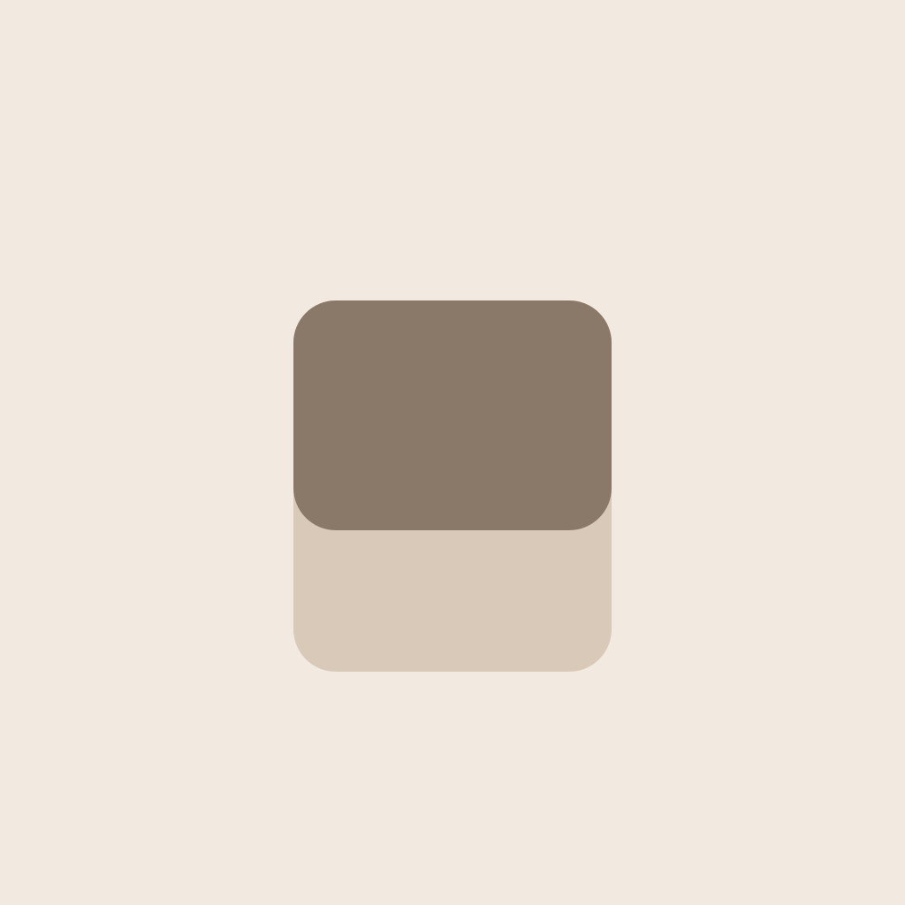
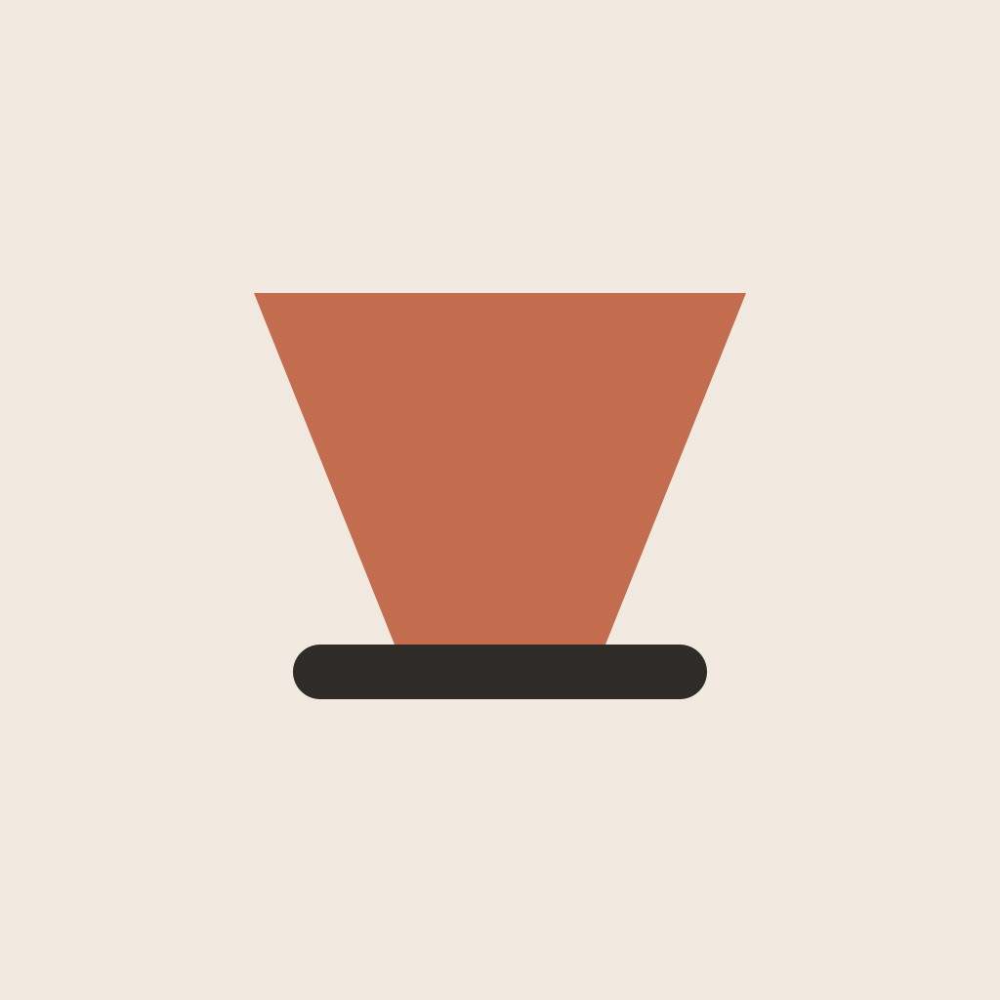

# MyBrand

MyBrand explores a simple idea for small and midsize creators: give fans a personal 3D world they can walk into. A creator shares images and website links, AI interprets their style, and the space changes what it puts on display as each fan explores.

## Inside the prototype

Kestrel & Clay, the demo ceramics studio, lets you try the fan experience. Walk through the boutique and inspect a piece that catches your eye. If you linger in a collection or inspect a product, the shop can spotlight a related piece on the central plinth or point you toward another display. Those changes belong to your visit.

<p>
  
  
</p>

*The espresso cup and ash-glaze dripper are two pieces from the demo catalog.*

## Try the demo

```sh
cd mybrand-starter/mybrand
npm ci
npm run dev
```

Open [Kestrel & Clay](http://localhost:5173/b/demo-brand) for the prebuilt boutique. The [studio homepage](http://localhost:5173) also has the creator flow for building a boutique from your own material.
