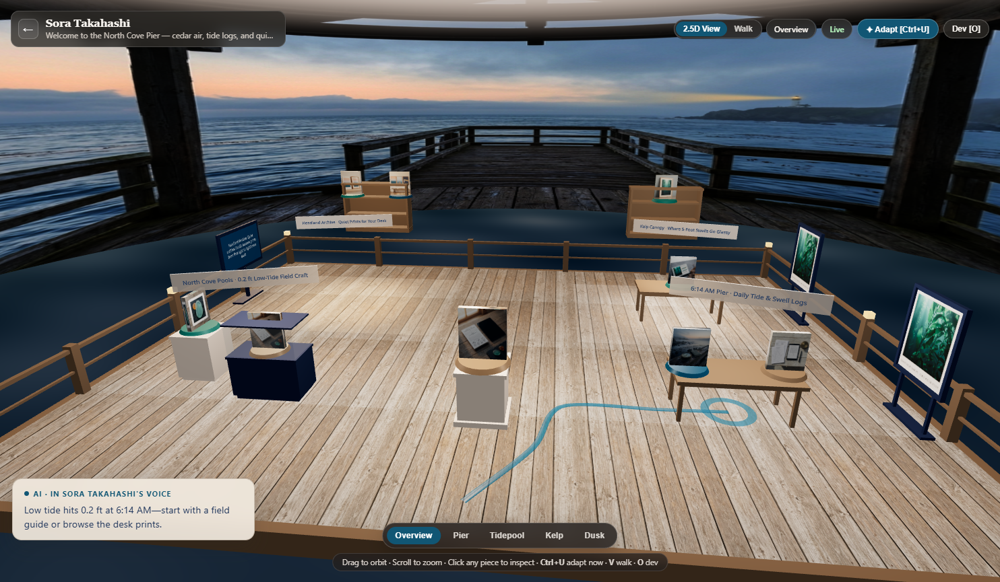

# MyBrand

MyBrand gives small and midsize creators a personal 3D world to share with fans. A creator shares images and website links so AI can pick up their style. As each fan explores, the world can change which products it puts on display.

On Sora Takahashi’s North Cove Pier, you can browse a tidepool field guide or stop by the kelp prints. What you inspect can change the piece on the central stand and where the blue path leads next.

**Try it locally.** From `mybrand-starter/mybrand`, run `npm ci` and `npm run dev`. Open [North Cove Pier](http://localhost:5173/b/sora-takahashi-99ea66) in a checkout with Sora’s saved world. Fresh clones include the [ceramics demo](http://localhost:5173/b/demo-brand).
